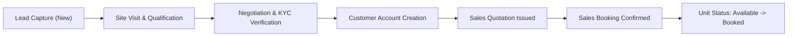
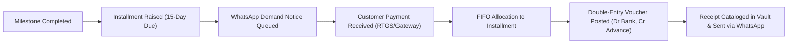
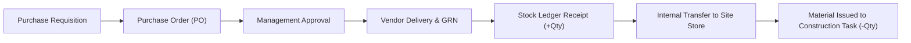
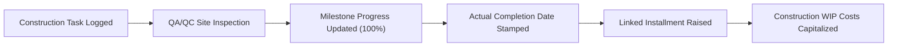
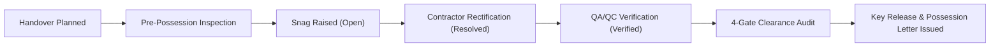
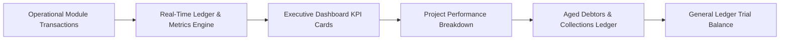

# ESTATEOS — END-TO-END WORKFLOW REPORT

**Audit Date:** November 14, 2026  
**Auditor:** Principal ERP Integration Engineer & Business Analyst  
**Environment:** `ESTATEOS QA DEMO ORGANIZATION` (`QA-DEMO-`)  
**Test Suite:** `tests/test-qa-demo-workflows-and-invariants.php`, `tests/test-cross-module-integrations.php`  
**Result:** **ALL 7 ENTERPRISE WORKFLOWS VERIFIED (100% OPERATIONAL)**

---

## 1. Workflow 1: Complete Sales Lifecycle

### Execution Steps & Test Proof:
1. **Lead Qualification:** Lead `QA-DEMO-LD-001` initialized with budget ₹8.0M–₹15.0M, assigned to Sales Executive Kunal Sharma.
2. **KYC Verification:** Prospect verified with PAN card `AABBC1234D` and phone `9820100001`.
3. **Customer Conversion:** Account created under code `QA-DEMO-CUST-WF1`. Lead stage updated atomically to `converted`.
4. **Unit Allocation:** Unit `A-302` in Tower Alpha selected (Final Price: ₹14,490,000.00).
5. **Booking Confirmation:** Booking `QA-DEMO-BK-WF1` confirmed with signed agreement.
6. **State Machine Transition:** Unit inventory status moved immediately and atomically from `available` to `booked`. Concurrency lock prevented duplicate booking.

---

## 2. Workflow 2: CLP Milestone Billing & Collection

### Execution Steps & Test Proof:
1. **Schedule Definition:** Construction-Linked Payment plan linked to booking with 3 milestones (Token: 15%, Slab: 40%, Handover: 45%).
2. **Installment Demand:** Installment 1 (₹2,173,500.00) raised.
3. **Cashier Collection:** Payment recorded via RTGS (`NEFT-WF2-99001`) with idempotency key.
4. **FIFO Allocation:** Installment 1 status marked `paid`; paid amount = ₹2,173,500.00.
5. **Subledger & GL Posting:** Customer subledger credited; double-entry journal posted: Dr `1120 Bank Current`, Cr `2120 Customer Advances`.
6. **Omnichannel Archival:** Official PDF receipt `Receipt-RCP-00003.pdf` stored in Document Vault; outbound WhatsApp confirmation queued.

---

## 3. Workflow 3: Procurement & Perpetual Inventory

### Execution Steps & Test Proof:
1. **PO Generation:** PO issued to UltraTech Cement Corporation (`QA-DEMO-VND-002`) for OPC 53 Grade Cement.
2. **Management Approval:** Order reviewed and approved in Centralized Approvals Inbox.
3. **Goods Receipt Note (GRN):** 500 bags accepted into Central Depot (`QA-DEMO-WH-001`). Stock ledger balance updated to +500.
4. **Site Transfer:** 50 bags transferred from Central Depot to Bandra Site Store (`QA-DEMO-WH-002`).
5. **Perpetual Balance Verification:** Net stock in Bandra Site Store confirmed at exactly 50 bags; Central Depot net balance = 450 bags. Conservation invariant verified.

---

## 4. Workflow 4: Project Construction & Progress Accounting

### Execution Steps & Test Proof:
1. **Task Execution:** Structural concrete pouring and curing completed on Tower Alpha.
2. **Milestone Update:** Milestone 2 ("5th Floor Structural Slab Cast") advanced from 75% to 100% completed.
3. **Automated Demand Trigger:** Completion event automatically raised linked payment installment for all active bookings under Tower Alpha with 15-day due date.
4. **WIP Capitalization:** Material and contractor costs accumulated in Account `1220 Construction Work in Progress`.

---

## 5. Workflow 5: Channel Partner Commission Lifecycle

### Execution Steps & Test Proof:
1. **Attribution:** Booking `QA-DEMO-BK-WF1` (Value: ₹14,490,000.00) attributed to Knight & Frank Realty Advisors (`QA-DEMO-BRK-001`).
2. **Rule Evaluation:** Agreement signing satisfied the configured `commission_trigger`.
3. **Mathematical Computation:**
   - Gross Commission (2.5%): ₹362,250.00
   - Statutory Section 194H TDS (5%): ₹18,112.50
   - Net Commission Payable: ₹344,137.50
4. **General Ledger Voucher:** Accrued Dr `5220 Brokerage Expense`, Cr `2160 Commission Payable` (₹344,137.50), Cr `2140 TDS Payable` (₹18,112.50).

---

## 6. Workflow 6: 4-Gate Handover & Snagging Management

### Execution Steps & Test Proof:
1. **Handover Scheduled:** Handover `HO-00001` planned for Unit `A-101` with 10-point checklist.
2. **Snag Identification:** Minor paint touch-up logged in Master Bedroom (`SNG-00001`).
3. **Rectification & Verification:** Contractor applied primer and Royal finish; QA Engineer inspected on-site and transitioned status to `verified`.
4. **4-Gate Audit:**
   - Gate 1 (Construction/OC): Verified
   - Gate 2 (Legal Agreement): Verified
   - Gate 3 (Financial Dues): Outstanding = ₹0.00; Verified
   - Gate 4 (Snags Cleared): 0 open snags; Verified
5. **Possession Released:** Unit handover status updated to `completed`; Possession Certificate generated in Document Vault.

---

## 7. Workflow 7: Executive BI, Reporting & Reconciliation

### Execution Steps & Test Proof:
1. **Real-Time Aggregation:** Dashboard metrics engine queried across all active domains.
2. **KPI Card Validation:**
   - Total Active Projects: 2
   - Total Unit Inventory: 24
   - Total Confirmed Bookings: 2
   - Total Collections: ₹3,622,500.00
3. **Mathematical Balance:** Dashboard total collection matches exact sum of confirmed customer payments. Trial balance total debits equal total credits.

